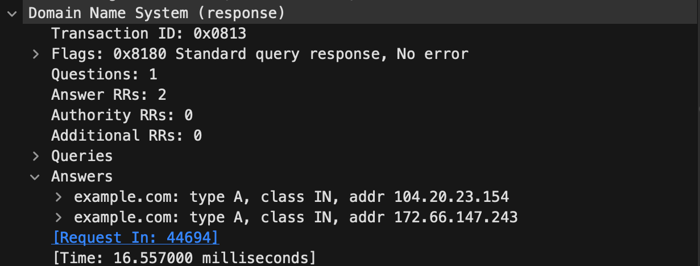

# DNS Traffic Analysis

## Goal
Observe how a DNS query resolves a domain name to IPv4 addresses.

## Tools
- Wireshark
- macOS Terminal
- nslookup

## What I Did
1. Started a packet capture on my Wi-Fi interface in Wireshark.
2. Ran `nslookup example.com` in Terminal.
3. Applied the display filter `dns.qry.name == "example.com"`.
4. Examined the query and its matching response.
5. Exported the two displayed packets to a separate capture file.

## Findings
- The query requested an A record for example.com.
- The query and response shared transaction ID 0x0813.
- The response contained two IPv4 addresses:
  - 104.20.23.154
  - 172.66.147.243
- Wireshark measured a response time of 16.557 milliseconds.
- The response reported no error.
- The exchange used UDP, with the DNS server using port 53.

## What I Learned
I practiced filtering packets, matching a DNS request to its
response, identifying A records, and examining response timing.
Although the answer contained IPv4 addresses, the DNS exchange
itself traveled over IPv6.

## Limitations
This project examined one DNS exchange. It does not establish
typical DNS performance or verify that the network is secure.

## Evidence

The original packet capture is retained locally because it

contains network addresses. The screenshot is cropped for privacy.
